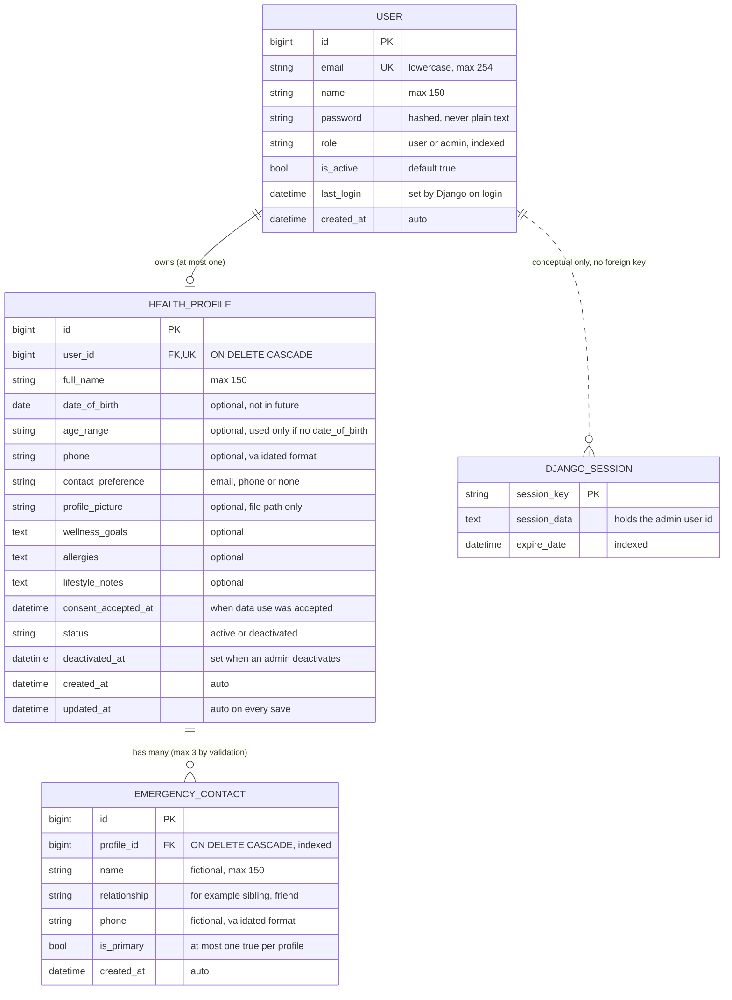

# ER Diagram

## Why each design choice

**Tables**
- **USER:** one table for both roles, with a `role` field. Simple, and permissions are checked server-side.
- **HEALTH_PROFILE:** separate from USER so login data and health data stay apart.
- **EMERGENCY_CONTACT:** a person can have several contacts, so they live in their own table instead of repeated columns.
- **DJANGO_SESSION:** framework-managed, used only for admin logins. User JWTs are stateless, so they are not stored in the database.

**Relationships**
- **USER to HEALTH_PROFILE (at most one):** the unique foreign key allows one profile per user. A profile is created automatically at signup for standard users. Admins have none.
- **HEALTH_PROFILE to EMERGENCY_CONTACT (many):** the database allows many. The limit of 3 is enforced by server-side validation and tested.
- **ON DELETE CASCADE:** deleting a user removes their profile, and deleting a profile removes its contacts, so no orphan data is left behind.
- **USER to DJANGO_SESSION (dotted):** a conceptual link only. Django stores the user id inside the session data, not as a database foreign key.

**Fields**
- **email:** stored lowercase and protected by a case-insensitive unique constraint, so `A@x.com` and `a@x.com` cannot both