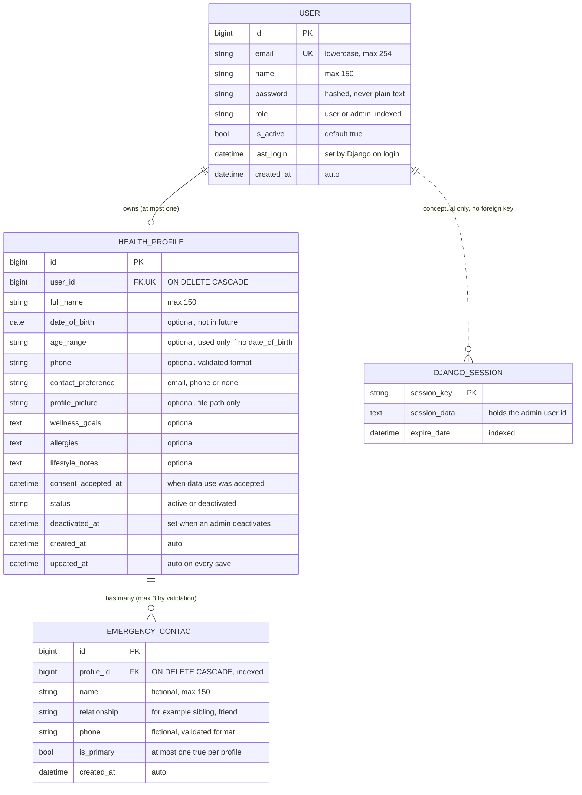

# ER Diagram

## Why each design choice

**Tables**
- **USER:** one table for both roles, with a `role` field. Simple, and permissions are checked server-side.
- **HEALTH_PROFILE:** separate from USER so login data and health data stay apart.
- **EMERGENCY_CONTACT:** a person can have several contacts, so they live in their own table instead of repeated columns.
- **DJANGO_SESSION:** framework-managed, used only for admin logins. User JWTs are stateless, so they are not stored in the database.

**Relationships**
- **USER to HEALTH_PROFILE (at most one):** the unique foreign key allows one profile per user. A profile is created automatically at signup for standard users. Admins have none.
- **HEALTH_PROFILE to EMERGENCY_CONTACT (many):** the database allows many. The limit of 3 is enforced by server-side validation and tested.
- **ON DELETE CASCADE:** deleting a user removes their profile, and deleting a profile removes its contacts, so no orphan data is left behind.
- **USER to DJANGO_SESSION (dotted):** a conceptual link only. Django stores the user id inside the session data, not as a database foreign key.

**Fields**
- **email:** stored lowercase and protected by a case-insensitive unique constraint, so `A@x.com` and `a@x.com` cannot both exist.
- **password:** stored as a hash, never as plain text.
- **role:** decides whether someone can reach admin endpoints.
- **last_login:** shows account activity to admins.
- **phone:** needed when the contact preference is "phone".
- **profile_picture:** only the file path is stored, never the image in the database.
- **consent_accepted_at:** proof the user accepted data use (privacy by design).
- **status and deactivated_at:** an admin can deactivate a profile without deleting it, and the time is recorded.
- **Deactivation rule:** when an admin deactivates a profile, `status` becomes "deactivated", `deactivated_at` is set, and the user's `is_active` becomes false, so they can no longer log in.
- **is_primary:** marks the first person to call. A conditional unique constraint allows only one primary per profile.
- **created_at and updated_at:** audit trail and newest-first sorting.
- **allergies and contacts:** optional and fictional, as the assignment requires. No diagnoses are stored.

## Rules enforced in code (and tested)
- A profile has `date_of_birth` or `age_range`, not contradictory values. A date of birth cannot be in the future.
- If `contact_preference` is "phone", a phone number is required.
- A profile can have at most 3 emergency contacts. A fourth is rejected.
- The first contact becomes primary automatically. A profile may have no contacts.
- Profile pictures must be JPG or PNG and at most 2 MB.
- Deactivating a profile also sets the user's `is_active` to false.

## Indexes and constraints (each has a real use)

| Index or constraint | Type | Why |
|---|---|---|
| USER lower(email) | Unique, case-insensitive | Fast login lookup and duplicate prevention, even if casing differs |
| USER.role | Normal | Quick admin vs user filtering |
| HEALTH_PROFILE.user_id | Unique | Enforces at most one profile per user and speeds the "my profile" lookup |
| HEALTH_PROFILE (status, created_at DESC) | Composite | Admin list filtered by status, newest first, with no extra sorting |
| EMERGENCY_CONTACT.profile_id | Normal | Fast loading of a profile's contacts |
| EMERGENCY_CONTACT (profile_id) where is_primary | Partial unique | Database guarantees at most one primary contact per profile |
| DJANGO_SESSION.expire_date | Normal | Fast cleanup of expired sessions |

## Security notes
- Plaintext passwords and JWT access tokens are not stored in the database. Passwords are securely hashed, and Django manages admin session records with its session framework.
- Profile pictures are checked for type and size, stored outside git, and only synthetic or avatar images are used.
- All data is synthetic.